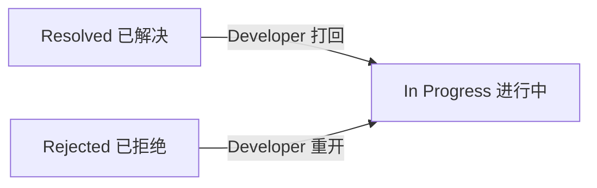
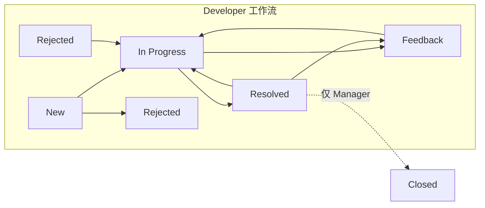
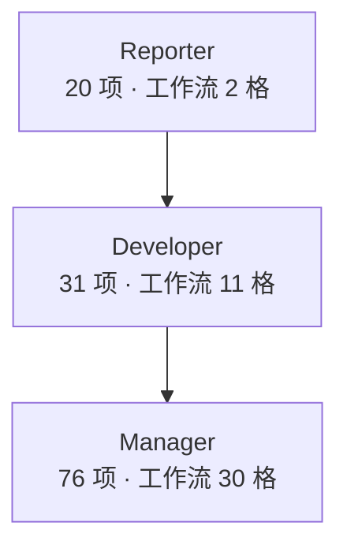

# Issue 模块需求规格说明书

**被测对象**：Redmine Issue（问题）模块　|　**版本**：v1.0　|　**规则编号**：FR-xx / NFR-xx

| 章节   | 内容                                                            |
| ---- | ------------------------------------------------------------- |
| 1    | 系统概述：角色、状态、优先级、跟踪标签、类别、版本                                     |
| 2    | 功能点规格 FR-1 ~ FR-14（每个功能点：输入项 / 输入规格 / 功能规则 / 提示语与反馈 / 适用测试维度） |
| 3    | 业务流程规则 BR-1 ~ BR-5（每段流程 + 流程图）                                |
| 4    | 非功能需求 NFR-1 ~ NFR-6                                           |
| 附录 A | 字段字典（**界面口径**）                                                |
| 附录 B | 规则编号索引                                                        |

> **字段与规则的出处**：本文每个字段、每条规则都按**三层来源**确定 —— ① **Redmine 官方 Wiki / 帮助文档**（定义字段与机制）② **同类产品字段词典**（Bugzilla / Jira，用来交叉验证字段划分是否完整）③ **本环境实测**（定义本项目实际行为，**优先级最高**）。**Redmine 官方没有需求规格说明书（SRS）**，需求只能这样拼出来；**凡查不到官方出处的，本文一律显式标注「待实测核对」或「本项目配置」，不冒充官方要求。** 接口侧字段见 `docs/1.3-接口文档-REST-API.md`（以官方 REST 文档为准，与本文互不引用）。
>
> **本文是输入侧文档**：只定义系统"应该怎样"，不含测试用例。用例在 `test-cases/3.2-界面用例-Issue模块-69条.md`（答案篇），推导方法见 `docs/2.4-测试方案-界面用例设计.md`（界面）与 `docs/2.5-测试方案-接口用例设计.md`（接口）。
>
> **⚠️ 提示语说明**：Redmine 是真实系统，下表"提示语与反馈"列填的是 **Redmine 标准校验文案，标注「待实测核对」** —— 执行用例时以实际弹出为准，发现不符请记录，回来订正。

---

## 1. 系统概述

### 1.1 角色

| 角色 | 界面名 | 职责 | 权限档位 |
|---|---|---|---|
| Reporter | 报告者 | 提交、补充信息 | 20 项 |
| Developer | 开发者 | 认领、修复、流转 | 31 项 |
| Manager | 管理者 | 分配、关闭、管成员 | 76 项 |

### 1.2 状态

| id  | 名称（界面锁英文，即界面显示） | 中文含义 | `is_closed` |
| :-: | --------------- | ---- | :---------: |
|  1  | New             | 新建   |      否      |
|  2  | In Progress     | 进行中  |      否      |
|  3  | Resolved        | 已解决  |      否      |
|  4  | Feedback        | 反馈   |      否      |
|  5  | Closed          | 已关闭  |      是      |
|  6  | Rejected        | 已拒绝  |      是      |

### 1.3 优先级

| id | 1 | 2 | 3 | 4 | 5 |
|---|---|---|---|---|---|
| 名称 | Low 低 | Normal 正常 | High 高 | Urgent 紧急 | Immediate 立即 |

### 1.4 跟踪标签（tracker）

| id | 名称 | 出现在路线图 |
|:--:|---|:--:|
| 1 | Bug | 否 |
| 2 | Feature | 是 |
| 3 | Support | 否 |

### 1.5 类别 / 版本（本项目数据）

| 类别 id | 1 前端 | 2 后端 | 3 数据库 |
|---|---|---|---|
| **版本 id** | 1 V1.1 | 2 V2.0 | |

### 1.6 本项目相对官方的有意偏离

| 项 | 官方默认 | 本项目 | 理由 |
|---|---|---|---|
| Reporter 权限 | 无 `edit_own_issues` | **增加** | 否则报告者连自己提的单都改不了 |
| Reporter 工作流 | 新建~已解决→Closed 共 5 格 | **收紧为 新建↔反馈 2 格** | 关闭权归 Manager，形成 2/11/30 梯度 |

## 2. 功能点规格

> **每个功能点一节**，含：**输入项 / 输入规格 / 功能规则 / 提示语与反馈 / 适用测试维度**。
> 这是界面层用例的直接来源。维度清单定义见 `2.3` 第 2 章。

### FR-1 创建 Issue

**输入项**（以实际「New issue」表单为准）：跟踪标签、主题、描述、状态、优先级、指派给、类别、目标版本、开始日期、截止日期、预估工时、完成百分比、附件。

**输入规格**

| 输入项 | 类型 | 必填 | 规格 |
| --- | --- | :-: | --- |
| 跟踪标签 Tracker | 下拉 | ✅ | Bug / Feature / Support，**默认 Bug** |
| 主题 Subject | 文本 | ✅ | 1~255 字符，非纯空白 |
| 描述 Description | 富文本 | ☐ | **无长度限制**；带格式工具栏 + Preview 预览切换 |
| 状态 Status | 下拉 | ✅ | **默认 New**；可选项受工作流约束（默认工作流下仅 New） |
| 优先级 Priority | 下拉 | ✅ | Low / Normal / High / Urgent / Immediate，**默认 Normal** |
| 指派给 Assignee | 下拉 | ☐ | 必须是该项目成员；带「Assign to me」快捷链接 |
| 类别 Category | 下拉 | ☐ | 本项目的类别 |
| 目标版本 Target version | 下拉 | ☐ | 本项目的版本 |
| 开始日期 Start date | 日期 | ☐ | 显示格式 `YYYY/MM/DD`，**默认当天** |
| 截止日期 Due date | 日期 | ☐ | 显示格式 `YYYY/MM/DD`，≥ 开始日期 |
| 预估工时 Estimated time | 时长 | ☐ | **`h:mm` 格式**，≥ 0 |
| 完成百分比 % Done | 下拉 | ☐ | 0~100，按 10 递增，**默认 0%** |
| 附件 Files | 文件 | ☐ | 单文件 ≤ 5 MB（界面写明 `Maximum size: 5 MB`） |

> **入口说明**：本项目的创建入口是「项目页 → 新建问题」，项目由入口锁定，**表单里没有「项目」这个字段**（只有不选项目的全局入口 `/issues/new` 才会出现项目下拉，本项目不用该入口）。**`FR-1` 的输入项就是上表这 13 个，一个不多、一个不少 —— 界面上没有的东西，不写进这个功能模块。**
>
> **关于日期字段**：`start_date` / `due_date` 用的是浏览器**原生日期控件**，界面上输入 `99` 会被**自动纠正为当月最后一天**，构造不出"非法日期格式"。所以 FR-1.6 的逆向**归接口层**（见 `1.3`：`start_date=2026-99-99`）；界面层只验证三件事：**开始日期默认当天**、**可清空**、**截止日期早于开始日期被拒**（F1-08）。

**功能规则**

| 编号      | 规则                                                          |
| ------- | ----------------------------------------------------------- |
| FR-1.1  | 所有必填项满足且各类校验通过 → 创建成功，自动生成编号                                |
| FR-1.2  | 主题为空 → 创建失败                                                 |
| FR-1.3  | 主题为纯空白 → 创建失败（视为空）                                          |
| FR-1.4  | 主题 > 255 字符 → 创建失败                                          |
| FR-1.5  | 截止日期早于开始日期 → 创建失败                                           |
| FR-1.6  | 日期格式非法 → 创建失败                                               |
| FR-1.7  | 预估工时 < 0 → 创建失败                                             |
| FR-1.8  | 跟踪标签 / 优先级 / 指派 / 类别 / 版本取值非法 → 创建失败（界面是下拉框，非法值须在接口层绕过前端验证） |
| FR-1.9  | 创建成功时**不产生变更历史**                                            |
| FR-1.10 | 校验必须在服务端成立（不能只靠前端）                                          |
| FR-1.11 | 未指定时取默认值：状态 New、优先级 Normal、完成百分比 0%、开始日期当天                  |
|         |                                                             |

**提示语与反馈**

| 触发场景   | 提示语（**待实测核对**）                                         | 表现             |
| ------ | ------------------------------------------------------ | -------------- |
| 主题为空   | `Subject cannot be blank`                              | 表单报错，Issue 未创建 |
| 主题超长   | `Subject is too long (maximum is 255 characters)`      | 同上             |
| 日期格式非法 | `Due date is invalid`                                  | 同上             |
| 截止早于开始 | `Due date must be greater than or equal to start date` | 同上             |
| 创建成功   | 无错误提示                                                  | 跳转/进入详情页，显示编号  |

**适用测试维度**：显示(空态) · **默认值** · 必填 · 格式 · 长度 · 数值范围 · 枚举 · 联动 · 上传 · 提示语 · 边界 · **交互(富文本工具栏 / Preview)**

### FR-2 查看

**输入项**：列表页过滤条件、排序列、自定义列；详情页无输入。

**输入规格**

| 输入项   | 规格                          |
| ----- | --------------------------- |
| 过滤条件  | 状态 / 优先级 / 指派 / 跟踪 / 日期，可组合 |
| 排序列   | 创建时间、优先级等，支持升/降序            |
| 搜索关键字 | 任意文本（含空）                    |
|       |                             |

**功能规则**

| 编号     | 规则                                                                    |
| ------ | --------------------------------------------------------------------- |
| FR-2.1 | 详情页展示全部字段：编号、项目、跟踪、状态、优先级、作者、指派、主题、描述、起止日期、完成百分比、预估工时、已用工时、创建/更新/关闭时间 |
| FR-2.2 | 详情页展示变更历史、关联、子任务、附件、观察者（存在时）                                          |
| FR-2.3 | 列表支持按状态/优先级/指派/组合条件过滤                                                 |
| FR-2.4 | 列表支持排序（升/降序）                                                          |
| FR-2.5 | 列表支持增删自定义列并保存到查询                                                      |
| FR-2.6 | 搜索可命中主题/描述关键词                                                         |

**提示语与反馈**：过滤/搜索无结果时列表显示"无数据"空态（**待实测核对**具体文案）。

**适用测试维度**：显示(空态) · 交互 · 过滤/搜索(含空关键字) · 排序 · 分页 · 状态 · 数据一致

### FR-3 编辑

**输入项**：同 FR-1 的可改字段 + 注释、私有注释开关。

**功能规则**

| 编号     | 规则                                        |
| ------ | ----------------------------------------- |
| FR-3.1 | 有权限者可修改字段，保存后更新                           |
| FR-3.2 | 每次修改产生一条变更历史；改 N 次产生 N 条                  |
| FR-3.3 | 注释进入历史记录，带作者与时间                           |
| FR-3.4 | 注释可设为私有（`private_notes`），仅具备权限的角色可见       |
| FR-3.5 | 报告者只能改**自己创建**的 Issue（`edit_own_issues`）  |
| FR-3.6 | 无权限者修改他人 Issue：界面无入口；拼 URL / 直接发请求应被服务端拒绝 |
|        |                                           |

**提示语与反馈**

| 场景 | 反馈（**待实测核对**） |
|---|---|
| 编辑成功 | 无错误，历史新增一条 |
| 无权限修改 | 404 / 403（Redmine 对无权限资源常返回 404 而非 403） |

**适用测试维度**：显示 · 必填 · 格式 · 长度 · 权限 · 交互 · 数据一致(历史)

### FR-4 状态流转（功能点视角）

> 状态机规则见 `BR-4`。

| 编号     | 规则                              |
| ------ | ------------------------------- |
| FR-4.1 | 状态下拉框选项由「当前状态 + 角色工作流」共同决定      |
| FR-4.2 | 非法转移的选项**不出现**在下拉框中             |
| FR-4.3 | 服务端必须拒绝非法转移                     |
| FR-4.4 | 状态变为 Closed / Rejected 后归入"已关闭" |

**提示语与反馈**：合法转移成功无提示；非法转移因选项不出现而**无法触发**（若通过接口强发，见 `1.3` 实测行为 OB-2）。

**适用测试维度**：状态/生命周期 · 枚举 · 权限 · 数据一致

### FR-5 关联

**输入项**：关联类型（相关/阻塞/重复/前置）、被关联的 Issue 编号。

**功能规则**

| 编号 | 规则 |
|---|---|
| FR-5.1 | 关联类型含 相关 related / 阻塞 blocks / 重复 duplicates / 前置 precedes |
| FR-5.2 | 关联建立后两条 Issue 详情页都能看到（含反向关联） |
| FR-5.3 | 存在未关闭的阻塞 Issue 时，被阻塞方不能关闭 |

**提示语与反馈**：关联成功无提示，关联区新增一行；不存在/无权限的 Issue 编号报错（**待实测核对**）。

**适用测试维度**：枚举(4 种类型) · 联动/依赖 · 权限 · 交互

### FR-6 子任务

**输入项**：父任务编号、子任务字段（同 FR-1）。

**功能规则**

| 编号 | 规则 |
|---|---|
| FR-6.1 | 一条 Issue 可作为父任务添加若干子任务 |
| FR-6.2 | 父任务详情页显示子任务列表 |
| FR-6.3 | 父任务完成百分比由子任务计算（3 个子任务关 1 个 → 33%） |
| FR-6.4 | 存在未关闭子任务时父任务不能关闭 |

**提示语与反馈**：关闭父任务时若有未关闭子任务，应提示不能关闭（**待实测核对**）。

**适用测试维度**：显示 · 联动(百分比) · 边界(0/1/全部) · 状态

### FR-7 附件

**输入项**：文件（类型/大小/数量）。

**功能规则**

| 编号     | 规则                |
| ------ | ----------------- |
| FR-7.1 | 可上传附件，跟随 Issue 保存 |
| FR-7.2 | 单个附件超大小上限 → 被拒    |
| FR-7.3 | 附件可下载，内容与上传一致     |
| FR-7.4 | 附件可删除             |

**提示语与反馈**

| 场景   | 反馈（**待实测核对**）                                                                   |
| ---- | ------------------------------------------------------------------------------- |
| 超限上传 | `This file cannot be uploaded because it exceeds the maximum allowed file size` |

**适用测试维度**：上传/文件(类型/大小/数量) · 显示 · 删除 · 数据一致

### FR-8 观察者

**输入项**：成员用户。

| 编号 | 规则 |
|---|---|
| FR-8.1 | 可将项目成员添加为观察者 |
| FR-8.2 | 观察者出现在"观察者"列表并收到通知 |

**适用测试维度**：枚举/多选 · 交互 · 权限

### FR-9 批量操作

**输入项**：勾选的多条 Issue、批量修改的目标值。

| 编号 | 规则 |
|---|---|
| FR-9.1 | 可勾选多条批量改状态 |
| FR-9.2 | 可勾选多条批量改指派 |
| FR-9.3 | 批量操作对每条分别校验权限与工作流 |

**提示语与反馈**：批量中部分无权限时，失败条数与原因应有提示（**待实测核对**）。

**适用测试维度**：单选/多选(单个/多个/全选) · 批量 · 权限 · 数据一致

### FR-10 导出

| 编号 | 规则 |
|---|---|
| FR-10.1 | 列表可导出 CSV，内容与当前列表一致 |
| FR-10.2 | 列表可导出 PDF |

**适用测试维度**：导出 · 数据一致 · 显示

### FR-11 复制 / 移动 / 删除

| 编号      | 规则                        |
| ------- | ------------------------- |
| FR-11.1 | 复制生成内容相同、编号不同的新 Issue     |
| FR-11.2 | 移动到其它项目后，原项目列表不再显示，目标项目可见 |
| FR-11.3 | 删除需有删除权限，删除后从列表消失且不可恢复    |

**提示语与反馈**

| 场景 | 反馈（**待实测核对**） |
|---|---|
| 无权限删除 | 403（无删除入口） |
| 删除确认 | 弹出二次确认 |

**适用测试维度**：操作(增删改查) · 权限 · 交互(确认弹窗) · 数据一致

### FR-12 工时

**输入项**：耗时数值、活动类型、注释、日期。

| 编号 | 规则 |
|---|---|
| FR-12.1 | 可在 Issue 上登记耗时 |
| FR-12.2 | 多条工时会累计，详情页显示累计耗时 |

**适用测试维度**：数值范围(0/负/超) · 联动(累计) · 显示

### FR-13 权限控制

| 编号 | 规则 |
|---|---|
| FR-13.1 | 操作能否执行 = **有权限**（第一级）**且** 工作流允许（第二级） |
| FR-13.2 | 权限项按角色配置（见 `docs/2.2-环境搭建指南.md` 第四章） |
| FR-13.3 | 权限校验必须在服务端；仅前端隐藏按钮不算防护 |
| FR-13.4 | 私有 Issue 只对具备权限的角色可见（**本环境界面上没有创建私有 Issue 的入口**，测试数据须由接口预置） |
| FR-13.5 | 私有注释只对具备权限的角色可见 |

**提示语与反馈**：越权访问常返回 **404**（Redmine 用 404 隐藏资源存在性），无权限操作按钮不显示。

**适用测试维度**：权限/角色 · 显示(可见性)

### FR-14 REST API

| 编号 | 规则 |
|---|---|
| FR-14.1 | 通过 REST API 可对 Issue 增删改查，规则见 `docs/1.3-接口文档-REST-API.md` |

## 3. 业务流程规则

### BR-1 缺陷闭环：报告者提单 → 开发者修复 → 管理者关闭

| 编号 | 规则 |
|---|---|
| BR-1.1 | 报告者提交后为 New |
| BR-1.2 | Developer 把 New → In Progress，合法 |
| BR-1.3 | Developer 把 In Progress → Resolved，合法 |
| BR-1.4 | 只有 Manager 能把 Resolved → Closed |
| BR-1.5 | 每个合法转移在对应角色下拉框中应可选 |

### BR-2 信息不足回退：报告者与开发者的往返

| 编号 | 规则 |
|---|---|
| BR-2.1 | Developer 可将 New → Feedback |
| BR-2.2 | Reporter 可将 Feedback → New |
| BR-2.3 | Reporter 只允许在 New ↔ Feedback 之间往返 |
| BR-2.4 | Reporter 不能 New → In Progress |
| BR-2.5 | Reporter 不能把状态改成任何 Closed |

### BR-3 打回重开：解决/拒绝后重新开始

| 编号 | 规则 |
|---|---|
| BR-3.1 | Developer 可将 Resolved → In Progress，合法 |
| BR-3.2 | Developer 可将 Rejected → In Progress，合法 |
| BR-3.3 | Developer 可将 New → Rejected，合法 |

### BR-4 状态机全量规则

| 编号 | 规则 | 角色 | 合法性 |
|---|---|---|:--:|
| BR-4.1 | 新建 → 进行中 | Developer | 合法 |
| BR-4.2 | 进行中 → 已解决 | Developer | 合法 |
| BR-4.3 | 已解决 → 进行中 | Developer | 合法 |
| BR-4.4 | 新建 → 已拒绝 | Developer | 合法 |
| BR-4.5 | 已拒绝 → 进行中 | Developer | 合法 |
| BR-4.6 | 已解决 → 已关闭 | Manager | 合法 |
| BR-4.7 | 新建 → 已关闭 | Manager | 合法（Manager 全通） |
| BR-4.8 | 新建 → 已关闭 | Developer | **非法**（跳步） |
| BR-4.9 | 已解决 → 新建 | Developer | **非法**（退回起点） |
| BR-4.10 | 任意状态 → 从 Closed 改出去 | 全体 | **非法**（终态） |
| BR-4.11 | 新建 → 进行中 / 已关闭 / 已解决 | Reporter | **非法**（越权） |

> **前提**：非法转移"测得出"依赖**收紧的工作流**。官方默认允许 Developer 从 New 直跳 Closed，用默认配置时 BR-4.8 不复现。

### BR-5 权限梯度与越权边界

| 编号 | 规则 |
|---|---|
| BR-5.1 | Reporter 不能修改他人 Issue |
| BR-5.2 | Reporter 不能删除 Issue |
| BR-5.3 | Reporter 不能访问成员管理页 |
| BR-5.4 | 非项目成员访问私有项目被拒 |
| BR-5.5 | 匿名访问 Issue 跳转登录 |
| BR-5.6 | Reporter 看不到他人私有 Issue |
| BR-5.7 | Reporter 看不到他人 Issue 的私有注释 |
| BR-5.8 | Manager 拥有全部管理权限 |

## 4. 非功能需求

> 对应 `2.3` 第 2.2 节的非功能维度。界面层与接口层都要覆盖。

| 编号    | 维度        | 需求                                                         |
| ----- | --------- | ---------------------------------------------------------- |
| NFR-1 | **UI 界面** | 各页面显示与布局**与 UI 原型一致**；列表/详情字段对齐、不溢出、不重叠                    |
| NFR-2 | **兼容性**   | 主流浏览器（Chrome / Edge / Firefox）下功能与布局一致                     |
| NFR-3 | **易用性**   | 操作路径顺畅；错误提示清晰可读、能指出问题字段                                    |
| NFR-4 | **性能**    | 列表/详情/创建/更新在正常负载下响应时间可接受（指标口径见 `3.3` 第三章）；并发读写错误率低         |
| NFR-5 | **安全**    | ① 未授权访问被拒；② 权限校验在服务端；③ 敏感信息（密码类字段）不出现在响应；④ 认证凭据错误/缺失返回认证错误 |
| NFR-6 | **异常/弱网** | 网络中断、请求超时的表现可接受；提交过程中断不产生脏数据                               |

---

## 附录 A：字段字典（**界面实测口径**）

> **本文是界面需求文档，字段清单以界面为准 —— 界面上没有的，本文一个都不写。**
> Redmine 的**数据模型和接口**里还有一批字段（如 `is_private` 私有、`custom_fields` 自定义字段），但它们在**本项目界面上不出现**，因此**不属于本文范围**，只在 `docs/1.3-接口文档-REST-API.md` 里定义。

**A-1　新建 / 更新表单上的字段**（界面实测）

| 字段                 | 界面标签  | 出现位置    | 界面必填 | 类型         | 取值 / 约束                                            | 相关规则             |
| ------------------ | ----- | ------- | :--: | ---------- | -------------------------------------------------- | ---------------- |
| `tracker_id`       | 跟踪标签  | 新建页、更新页 |  ✅★  | 下拉         | Bug / Feature / Support，默认 Bug                     | FR-1.8           |
| `subject`          | 主题    | 新建页、更新页 |  ✅★  | 文本         | 1~255 字符，非纯空白                                      | FR-1.2~1.4       |
| `description`      | 描述    | 新建页、更新页 |  ☐   | 富文本        | 无长度限制                                              | FR-1.1           |
| `status_id`        | 状态    | 新建页、更新页 |  ✅★  | 下拉         | 默认 New；可选项受工作流约束                                   | FR-4 / BR-4      |
| `priority_id`      | 优先级   | 新建页、更新页 |  ✅★  | 下拉         | Low / Normal / High / Urgent / Immediate，默认 Normal | FR-1.8           |
| `assigned_to_id`   | 指派给   | 新建页、更新页 |  ☐   | 下拉         | 项目成员                                               | FR-1.8           |
| `category_id`      | 类别    | 新建页、更新页 |  ☐   | 下拉         | 本项目的类别                                             | FR-1.8           |
| `fixed_version_id` | 目标版本  | 新建页、更新页 |  ☐   | 下拉         | 本项目的版本                                             | FR-1.8           |
| `start_date`       | 开始日期  | 新建页、更新页 |  ☐   | 原生日期控件     | 显示 `YYYY/MM/DD`，默认当天                               | FR-1.6 / FR-1.11 |
| `due_date`         | 截止日期  | 新建页、更新页 |  ☐   | 原生日期控件     | 显示 `YYYY/MM/DD`，≥ 开始日期                             | FR-1.5           |
| `estimated_hours`  | 预估工时  | 新建页、更新页 |  ☐   | `h:mm` 文本框 | ≥ 0                                                | FR-1.7           |
| `done_ratio`       | 完成百分比 | 新建页、更新页 |  ☐   | 下拉         | 0~100，步长 10，默认 0%                                  | FR-1.11          |
| `uploads`          | 附件    | 新建页、更新页 |  ☐   | 文件         | 单文件 ≤ 5 MB（界面写明 `Maximum size: 5 MB`）              | FR-7             |

**A-2　其它界面上的字段**（**不在创建表单内**，各有自己的功能点）

| 字段                 | 界面标签      | 出现位置                                     | 相关功能点  |
| ------------------ | --------- | ---------------------------------------- | ------ |
| `parent_issue_id`  | 父任务 / 子任务 | **详情页 · Subtasks 区块**（点「Add」建立）          | FR-6   |
| `watcher_user_ids` | 观察者       | **详情页 · 侧边栏 Watchers**（点「Add」添加）         | FR-8   |
| `notes`            | 注释        | **详情页 · 更新表单**的文本框                       | FR-3.3 |
| `private_notes`    | 私有注释      | **详情页 · 更新表单**（需 `set_notes_private` 权限） | FR-3.4 |
| `spent_hours`      | 已用工时      | **详情页 · 记录工时**（累计只读展示）                   | FR-12  |

> **界面必填（★）说明**：新建页上带红星的实际只有 **Tracker / Subject / Status / Priority** 四项。
> **A-1 与 A-2 的边界**：A-1 是「创建 / 更新 Issue」这个表单上的字段；A-2 的字段**在表单上不出现**，从各自的入口进入才有（子任务从详情页 Subtasks、观察者从侧边栏、注释/工时的入口在详情页）——**设计 FR-1 时不要把它们算进来**。
> **接口专有字段**（界面上不出现的）：`project_id`（仅全局入口 `/issues/new` 有，本项目不用）、`is_private`、`custom_fields`、`tracker_id` 等参数的 id 形式 —— 见 `docs/1.3-接口文档-REST-API.md`。

## 附录 B：规则编号索引

| 编号区间         | 对应功能点 / 流程             | 主要用例落点（`3.2`，2026-09-28 起按功能点分组） |
| ------------ | ---------------------- | ------------------------- |
| FR-1.1~1.11  | 创建                     | F1-01 ~ F1-10             |
| FR-2.1~2.6   | 查看                     | F2-01、F10-01 ~ F10-14、F11-01 ~ F11-02 |
| FR-3.1~3.6   | 编辑                     | F3-01、F3-02、P-01          |
| FR-4.1~4.4   | 状态流转                   | S-01 ~ S-10               |
| FR-5.1~5.3   | 关联                     | F5-01 ~ F5-04             |
| FR-6.1~6.4   | 子任务 / 父任务              | F6-01 ~ F6-03             |
| FR-7.1~7.4   | 附件                     | F7-01 ~ F7-04             |
| FR-8.1~8.2   | 观察者（关注者）               | F9-01、F9-02               |
| FR-9.1~9.3   | 批量操作                   | F12-01、F12-02             |
| FR-10.1~10.2 | 导出                     | F13-01、F13-02             |
| FR-11.1~11.3 | 复制/移动/删除               | F4-01 ~ F4-03             |
| FR-12.1~12.2 | 工时                     | F8-01                     |
| FR-13.1~13.5 | 权限控制                   | P-01 ~ P-09               |
| FR-14.1      | REST API               | API-01 ~ API-87           |
| BR-1 ~ BR-4  | 状态机流程                  | S-01 ~ S-10               |
| BR-5         | 越权流程                   | P-01 ~ P-09               |
| NFR-1~NFR-6  | 非功能（UI/兼容/易用/性能/安全/弱网） | 界面非功能节 / API-78 ~ API-87   |

---

## 附录 C：规则 → 用例 引导问题（选做）

1. FR-1 的 10 条规则，用 `2.3` 第 2 章 22 个功能维度核对，哪些维度没覆盖到？
2. FR-1.2~1.4（主题）能推出几条用例？正向取哪些、逆向取哪些、边界取哪两个点？
3. FR-1.5（日期不倒挂）推出什么用例？属哪种设计方法？
4. 把 FR-1 过一遍 `2.3` 的 6 个**非功能**维度，各列 1 条用例。
5. BR-4 里 Developer 从 New / Resolved 各能到哪几个状态？合法+非法共几条用例？
6. BR-4.8 若不收紧工作流会怎样？这说明"定制工作流"的意义？
7. 为什么越权测试不能只看前端按钮？怎么验证服务端做了校验？
8. FR-13.4 / FR-13.5 分别要设计什么用例？"谁能看"的依据在哪？
9. （读 `1.3` 后）"PUT/DELETE 返回 204 且 204 不代表改成功"对越权接口用例设计有何影响？
10. 把 FR-1~FR-14 过一遍，哪个功能点你一条用例都没有？
