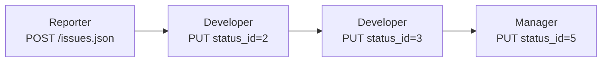
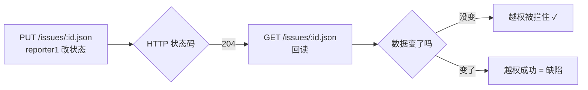

# Redmine REST API 接口文档

**接口范围**：Issue 模块及其相关接口　|　**版本**：v1.0　|　**规则编号**：IR-xx

| 章节   | 内容                                             |
| ---- | ---------------------------------------------- |
| 1    | 通用约定（认证 / 格式 / 分页 / include）                   |
| 2    | 接口功能点规则 IR-1 ~ IR-10（每个接口一节：请求 / 响应 / 规则 / 示例） |
| 3    | 接口业务流程 BRA-1 ~ BRA-3（多接口串联 + 流程图 + 调用序列示例）     |
| 4    | 状态码与错误约定                                       |
| 5    | 本环境实测行为                                        |
| 附录 A | 接口字段字典（官方 REST 口径）                             |
| 附录 B | 接口编号索引                                         |

> **本文是输入侧文档**：定义接口"长什么样"，不含测试用例。用例在 `test-cases/3.3-接口用例-87条.md`（答案篇）。
>
> **依据（唯一权威来源）= Redmine 官方 REST API 文档**：
> - **Issues 端点与参数**：`https://www.redmine.org/projects/redmine/wiki/rest_issues`
> - **通用约定（认证 / 分页 / 附件 / 错误）**：`https://www.redmine.org/projects/redmine/wiki/rest_api`
>
> **本文的端点、参数名、`include` 取值、状态码，一律照官方文档原文。** 官方没写、但本环境实测到的，收在第 5 章「本环境实测」并标 **〔实测〕**。
>
> **接口文档与界面需求文档（`1.2`）是两套独立口径**：`1.2` 的字段以**界面**为准，本文的字段以**官方 REST 文档**为准。接口字段里有界面上没有的（如 `is_private` 私有、`custom_fields` 自定义字段），这是正常的 —— **两边互不引用、互不依据**。

---

## 1. 通用约定

### 1.1 基地址

```
http://localhost:3000
```

### 1.2 认证

| 项           | 内容                                                                                              |
| ----------- | ----------------------------------------------------------------------------------------------- |
| 前置开关        | **管理 → 设置 → API → 勾选「启用 REST Web Service」**，否则 API 不可用                                          |
| 方式一         | HTTP Basic 认证：**登录名 + 密码**                                                                      |
| 方式二         | 查询参数 `?key=<API key>`                                                                           |
| 方式三         | 用户名填 API key、密码随机，走 Basic 认证                                                                    |
| 方式四（推荐）     | 请求头 **`X-Redmine-API-Key: <key>`**（1.1.0+）                                                      |
| API key 在哪拿 | 登录后 `/my/account` 页面右侧栏                                                                         |
| 用户模拟        | 请求头 **`X-Redmine-Switch-User: <login>`**（2.2.0+）。**仅管理员账号有效**，普通账号下该头被忽略；指定的用户不存在或未激活 → **412** |

| 规则编号    | 规则                                                    |
| ------- | ----------------------------------------------------- |
| IR-0.1  | 未启用 REST API 时请求被拒（〔实测〕本项目返回 **403**，响应体为空）           |
| IR-0.2  | Key 错误或缺失 → 401〔实测〕                                   |
| IR-0.3  | 无权限访问管理员接口 → 403                                      |
| IR-0.3b | `X-Redmine-Switch-User` 指向不存在 / 未激活用户 → **412**（官方原文） |

### 1.3 数据格式

| 项                  | 内容                                                                                                    |
| ------------------ | ----------------------------------------------------------------------------------------------------- |
| 格式                 | JSON 或 XML，由路径后缀决定（`/issues.json` / `/issues.xml`）                                                    |
| Content-Type       | POST / PUT **必须**显式设置：JSON → `application/json`，XML → `application/xml`（**哪怕 URL 已带 `.json` 后缀也必须设**） |
| 上传文件的 Content-Type | 调 `POST /uploads.json` 时必须是 `application/octet-stream`，否则 **406 Not Acceptable**                      |

| 规则编号 | 规则 |
|---|---|
| IR-0.4 | POST / PUT **缺 Content-Type** → 请求无法解析（官方原文「MUST be specified even if the remote URL is suffixed accordingly」） |
| IR-0.5 | 请求体不是合法 JSON → 400〔实测〕 |
| IR-0.5b | 上传附件时 Content-Type 不是 `application/octet-stream` → **406**（官方原文） |

### 1.4 分页

| 参数 | 含义 |
|---|---|
| `offset` | 跳过前 N 条 |
| `limit` | 本页条数（默认 25，**最大 100**） |
| `page` | 页码（`offset` 与 `page` 同时给出时 offset 优先） |

| 规则编号 | 规则 |
|---|---|
| IR-0.6 | 列表响应含元信息：`total_count` / `limit` / `offset` |
| IR-0.7 | 加 `nometa=1`（或请求头 `X-Redmine-Nometa: 1`）可去掉元信息 |

### 1.5 关联数据 include

> **官方文档里，列表接口和详情接口的 `include` 取值不是一套**（原文如下）。

**① 列表 `GET /issues.[format]`** — 官方只列了 2 个

| 取值 | 拉取内容 | 版本 |
|---|---|---|
| `attachments` | 附件 | 3.4.0+ |
| `relations` | 关联关系 | — |

**② 详情 `GET /issues/[id].[format]`** — 官方列了 8 个

| 取值 | 拉取内容 | 版本 |
|---|---|---|
| `children` | 子任务 | — |
| `attachments` | 附件 | — |
| `relations` | 关联关系 | — |
| `changesets` | 关联的代码提交 | — |
| `journals` | 变更历史 / 注释 | — |
| `watchers` | 观察者 | 2.3.0+ |
| `allowed_statuses` | **当前允许切换到的状态**（可直接拿来验证工作流） | 5.0.x+ |
| `reactions` | 表情回应 | 7.1.0+ |

| 规则编号 | 规则 |
|---|---|
| IR-0.8 | 默认不返回关联对象，需用 `include=xxx,yyy` 显式声明（逗号分隔可多项） |

## 2. 接口功能点规则

### IR-1 验证认证　`GET /users/current.json`

**请求**
```
GET /users/current.json
X-Redmine-API-Key: <key>
```
**响应（200）**
```json
{ "user": { "id": 1, "login": "admin", "firstname": "…", "lastname": "…", "mail": "…" } }
```

| 规则编号 | 规则 |
|---|---|
| IR-1.1 | 正确 Key → 200，返回当前用户信息 |
| IR-1.2 | 错误 Key / 缺 Key 头 → 401 |

### IR-2 创建 Issue　`POST /issues.json`

**官方参数**（`issue` 哈希，照官方 REST 文档原文）

| 参数 | 说明 |
|---|---|
| `project_id` | 项目 id |
| `tracker_id` | 跟踪标签 id |
| `status_id` | 状态 id |
| `priority_id` | 优先级 id |
| `subject` | 主题 |
| `description` | 描述 |
| `category_id` | 类别 id |
| `fixed_version_id` | 目标版本 id（官方注：previously called 'Fixed Version'） |
| `assigned_to_id` | 指派给的用户 id（**没有按名字指派的机制**） |
| `parent_issue_id` | 父任务 id |
| `custom_fields` | 自定义字段数组 |
| `watcher_user_ids` | 观察者用户 id 数组（2.3.0+） |
| `is_private` | `true` / `false`，是否私有 |
| `estimated_hours` | 预估工时（小时数） |
| `uploads` | 附件 token 数组（见 IR-8） |

**请求**
```json
{ "issue": { "project_id": 1, "subject": "示例主题", "tracker_id": 1,
             "priority_id": 2, "assigned_to_id": 5,
             "start_date": "2026-09-24", "due_date": "2026-10-08", "estimated_hours": 8.5 } }
```
**响应（201）**：新建 Issue 对象，含 `id`。

| 规则编号 | 规则 |
|---|---|
| IR-2.1 | 请求体外层必须包 `issue` 对象 |
| IR-2.2 | `project_id` 必填，取值须为存在的项目 |
| IR-2.3 | `subject` 必填，1~255 字符，非纯空白 |
| IR-2.4 | 各参数的取值约束见**本文附录 A**（接口字段字典） |
| IR-2.5 | 缺必填或取值非法 → 422，响应体含 `errors` 列表 |
| IR-2.6 | 引用类字段一律传数字 id（不能传名字） |
| IR-2.7 | `start_date` / `due_date` / `done_ratio`：**官方创建参数表里没列**，但它们出现在官方 GET 响应示例中，〔实测〕创建时传也生效 → 本环境按"可用"处理 |

### IR-3 查询详情　`GET /issues/:id.json`

**请求**：`GET /issues/10.json?include=journals,attachments`
**响应（200）**：单条 Issue 全字段（见附录 A）。

| 规则编号 | 规则 |
|---|---|
| IR-3.1 | 存在的 Issue → 200 |
| IR-3.2 | 不存在的 Issue → 404 |

### IR-4 更新 Issue　`PUT /issues/:id.json`

**请求**
```json
{ "issue": { "subject": "新主题", "status_id": 2, "notes": "说明", "private_notes": false } }
```
**响应**：**204 No Content**（无响应体）

| 规则编号 | 规则 |
|---|---|
| IR-4.1 | 更新成功 → **204**（不是 200） |
| IR-4.2 | **204 不代表改成功**：非法状态转移、越权修改也返回 204，但数据不变 |
| IR-4.3 | 因此 PUT 类用例**必须回读验证**（改完再 GET 一次） |
| IR-4.4 | 每修改一次产生一条 journal |

### IR-5 删除 Issue　`DELETE /issues/:id.json`

**响应（成功）**：**204 No Content**

| 规则编号 | 规则 |
|---|---|
| IR-5.1 | 删除成功 → 204 |
| IR-5.2 | 无删除权限 → 403 |
| IR-5.3 | 删除后再次 GET → 404 |

### IR-6 列表与过滤　`GET /issues.json`

**请求示例**：`GET /issues.json?project_id=1&status_id=closed&limit=100`

| 参数 | 说明 |
|---|---|
| `project_id` | 按项目（**数字 id，不是项目标识符**） |
| `subproject_id` | 按子项目；`project_id=XXX&subproject_id=!*` = 只看本项目、不含子项目 |
| `issue_id` | 按 id，逗号分隔可多个（如 `issue_id=1,2`） |
| `tracker_id` / `status_id` / `assigned_to_id` | 按标签 / 状态 / 指派人（`status_id` 可为 `open`/`closed`/`*`；`assigned_to_id` 可用 `me`） |
| `parent_id` | 按父任务 id |
| `cf_x` | 按自定义字段值（字段须勾选 "used as a filter"），如 `cf_4=~foo` 表示包含子串 |
| `created_on` / `updated_on` | 按创建 / 更新时间范围，如 `created_on=>=2012-03-01` |
| `sort` | 排序列，`:desc` 表示倒序，如 `sort=category:desc,updated_on` |
| `offset` / `limit` / `page` | 分页（见 1.4） |

> **注意（官方原文）**：含有 `>`、`<`、`=` 的操作符必须做 **hex 编码**，否则解析不正确（如 `created_on=%3E%3D2012-03-01`）。

| 规则编号 | 规则 |
|---|---|
| IR-6.1 | 返回 `issues` 数组 + 元信息 |
| IR-6.2 | 默认只返回未关闭的 Issue |
| IR-6.3 | 用不存在的 `project_id` 过滤 → **404**（不是空列表）〔实测〕 |

### IR-7 用户列表　`GET /users.json`

| 规则编号 | 规则 |
|---|---|
| IR-7.1 | 仅管理员可调用；非管理员 → 403 |

### IR-8 上传附件　`POST /uploads.json?filename=image.png`

**请求**：请求体为文件内容，`Content-Type: application/octet-stream`（**否则 406**）
**响应（201）**：`{"upload":{"token":"<token>"}}`

**挂载方式**：创建 / 更新 Issue 时带 `uploads` 数组
```json
{ "issue": { "project_id": "1", "subject": "带附件的 Issue",
             "uploads": [ {"token": "7167.ed1ccdb093229ca1bd0b043618d88743", "filename": "image.png"} ] } }
```

| 规则编号 | 规则 |
|---|---|
| IR-8.1 | 上传成功 → 201，返回 token |
| IR-8.2 | 拿到 token 后，在创建/更新 Issue 时用 `uploads` 数组挂载附件（可一次带多个文件） |
| IR-8.3 | 超过大小上限 → 422，官方错误原文：`This file cannot be uploaded because it exceeds the maximum allowed file size (1024000)` |
| IR-8.4 | Content-Type 不是 `application/octet-stream` → **406 Not Acceptable**（官方原文） |
| IR-8.5 | 7.1.0 起 `content_type` 属性**被忽略**，Redmine 自行探测文件真实类型（不报错、也不生效） |

### IR-9 加观察者　`POST /issues/:id/watchers.json`

**请求**：`{"user_id": 5}`　**响应（201）**

| 规则编号 | 规则 |
|---|---|
| IR-9.1 | 成功 → 201，用户出现在观察者列表 |

### IR-10 移除观察者　`DELETE /issues/:id/watchers/:user_id.json`

| 规则编号 | 规则 |
|---|---|
| IR-10.1 | 成功 → 204 |

## 3. 接口业务流程

### BRA-1 CRUD 闭环：创建 → 更新 → 查询 → 删除


**调用序列示例**
```
1. POST /issues.json   {"issue":{"project_id":1,"subject":"流程演示"}}      → 201  {id:10}
2. PUT  /issues/10.json {"issue":{"status_id":2}}                          → 204
3. GET  /issues/10.json                                                     → 200  status=In Progress
4. DELETE /issues/10.json                                                   → 204
5. GET  /issues/10.json                                                     → 404
```

| 规则编号 | 规则 |
|---|---|
| BRA-1.1 | 创建返回的 id 是后续操作的路径参数 |
| BRA-1.2 | 更新后必须回读，才能确认"确实改了"（见 IR-4.2） |
| BRA-1.3 | 删除后回读应返回 404 |

### BRA-2 缺陷闭环（跨角色）



| 规则编号 | 规则 |
|---|---|
| BRA-2.1 | 每个步骤必须用**对应角色的 Key**（跨角色操作换 Key） |
| BRA-2.2 | Developer 无权把 status_id 改为 5（Closed），改了也不生效 |
| BRA-2.3 | 最终 Manager 关闭成功，回读 status 为 Closed |

### BRA-3 状态流转校验（回读验证）



| 规则编号 | 规则 |
|---|---|
| BRA-3.1 | 非法转移 / 越权时，状态码往往仍是 204，**必须回读判定** |
| BRA-3.2 | 回读数据未变 → 判定为"被正确拦住" |
| BRA-3.3 | 回读数据已变 → 判定为缺陷 |

## 4. 状态码与错误约定

| 码 | 语义 | 出现场景 | 依据 |
|:--:|---|---|---|
| 200 | 成功（有内容） | GET 详情 / 列表 | 官方 |
| 201 | 创建成功 | POST 创建 / 上传 / 加观察者 | 官方 |
| **204** | 成功（无内容） | **PUT 更新 / DELETE 删除** | 〔实测〕 |
| 400 | 请求不合法 | 请求体不是合法 JSON | 〔实测〕 |
| 401 | 未认证 | Key 错误 / 缺失 | 〔实测〕 |
| 403 | 无权限 | 权限不足；REST API 未启用 | 〔实测〕 |
| 404 | 不存在 | 查/改/删不存在的 Issue；过滤不存在的 project_id | 〔实测〕 |
| **406** | Content-Type 不可接受 | 上传附件时未用 `application/octet-stream` | 官方 |
| **412** | 前置条件不满足 | `X-Redmine-Switch-User` 指向不存在/未激活用户 | 官方 |
| 422 | 参数不合法 | 缺必填、取值非法、业务规则不满足、附件超限 | 官方 |

> **「依据」列**：官方 = 官方 REST 文档明写；〔实测〕= 官方未明写、本项目实际测到。**Put/Delete 返回 204 而不是 200 是实测结论**，官方文档没有承诺。

**422 响应体格式**
```json
{ "errors": [ "Subject can't be blank", "Due date is invalid" ] }
```

| 规则编号 | 规则 |
|---|---|
| IR-11.1 | 400 = 请求读不懂；422 = 请求读懂了但字段值非法 |
| IR-11.2 | 422 响应必须包含具体错误信息，断言时除状态码外应校验错误信息 |

## 5. 本环境实测行为

> 实测到的行为，作为需求分析的重点观察对象。

| 编号 | 行为 | 性质 |
|---|---|---|
| OB-1 | REST API 默认关闭 → 所有请求 403 且响应体为空 | 环境前提 |
| OB-2 | PUT/DELETE 成功返回 204；越权 / 非法转移也返回 204 但数据不变 | 需回读 |
| OB-3 | `priority_id` 无效值 → 422；`status_id`/`tracker_id` 无效值 → 201 静默回落默认值 | 处理不一致 |
| OB-4 | 无权操作：修改 → 204 静默；删除 → 403 报错 | 拒绝方式不统一 |
| OB-5 | 匿名可读 `/issues.json`、`/projects.json`；不可读 `/users.json`、`/time_entries.json` | 设计意图 |
| OB-6 | `subject` 255 通过 / 256 返回 422 | 边界 |
| OB-7 | 非法 JSON → 400（非 422） | 见 IR-11.1 |
| OB-8 | 创建不产生 journal；改 N 次产生 N 条 | 变更历史 |
| OB-9 | 创建 body 传 `{}` → 422；过滤不存在的 project_id → 404 | 边界 |

---

## 附录 A：接口字段字典（**官方 REST 口径**）

> **本表的字段以官方 REST 文档为准，与界面（`1.2`）无关。** 界面上看不到的 `is_private` / `custom_fields` 出现在这里很正常 —— **接口字段本来就比表单字段多**，这是两套口径。

**A-1　可写参数**（`POST /issues.json` 创建 / `PUT /issues/:id.json` 更新）

| 参数 | 类型 | 说明 | 适用 |
|---|---|---|---|
| `project_id` | 数字 id | 项目 | 创建必填 |
| `tracker_id` | 数字 id | 跟踪标签 | 创建 / 更新 |
| `status_id` | 数字 id | 状态 | 创建 / 更新 |
| `priority_id` | 数字 id | 优先级 | 创建 / 更新 |
| `subject` | 文本 | 主题（≤255 字符） | 创建 / 更新 |
| `description` | 文本 | 描述 | 创建 / 更新 |
| `category_id` | 数字 id | 类别 | 创建 / 更新 |
| `fixed_version_id` | 数字 id | 目标版本（官方注：旧称 Fixed Version） | 创建 / 更新 |
| `assigned_to_id` | 数字 id | 指派给（**无按名字指派的机制**） | 创建 / 更新 |
| `parent_issue_id` | 数字 id | 父任务 | 创建 / 更新 |
| `custom_fields` | 数组 | 自定义字段值 | 创建 / 更新 |
| `watcher_user_ids` | 数组 | 观察者用户 id（2.3.0+） | 创建 |
| `is_private` | 布尔 | 是否私有（`true` / `false`） | 创建 / 更新 |
| `estimated_hours` | 数字 | 预估工时 | 创建 / 更新 |
| `uploads` | 数组 | 附件 token（见 IR-8） | 创建 / 更新 |
| `notes` | 文本 | 本次更新附加的注释 | **仅更新** |
| `private_notes` | 布尔 | 注释是否私有 | **仅更新** |

**A-2　响应中的主要只读字段**

| 字段 | 说明 |
|---|---|
| `id` | Issue 编号 |
| `project` / `tracker` / `status` / `priority` / `author` / `assigned_to` | 关联对象（含 `id` + `name`） |
| `done_ratio` | 完成百分比（0~100） |
| `start_date` / `due_date` | 起止日期 |
| `created_on` / `updated_on` / `closed_on` | 创建 / 更新 / 关闭时间 |
| `custom_fields` | 自定义字段数组 |
| `journals` | 变更历史（需 `include=journals`） |
| `children` / `attachments` / `relations` / `changesets` / `watchers` | 关联数据（需 `include=`，取值见 1.5） |

**A-3　查询参数**

见 **IR-6** 的参数表（`project_id` / `subproject_id` / `issue_id` / `tracker_id` / `status_id` / `assigned_to_id` / `parent_id` / `cf_x` / `created_on` / `updated_on` / `sort`）与 **1.4 分页**（`offset` / `limit` / `page` / `nometa`）。

## 附录 B：接口编号索引

| 编号区间 | 接口 | 用例落点（`3.3`） |
|---|---|---|
| IR-1 | 验证认证 | API-01 ~ API-05 |
| IR-2 | 创建 | API-06 ~ API-35 |
| IR-3 | 查询详情 | API-36 ~ API-42 |
| IR-4 | 更新 | API-43 ~ API-55 |
| IR-5 | 删除 | API-56 ~ API-61 |
| IR-6 | 列表过滤 | API-62 ~ API-69 |
| IR-7 | 用户列表 | API-05、API-87 |
| IR-8 | 上传附件 | 附件相关用例 |
| IR-9 / IR-10 | 观察者 | 观察者相关用例 |
| BRA-1 ~ BRA-3 | 业务流程 | API-70 ~ API-77 |
| NFR（性能/安全） | — | API-78 ~ API-87 |

---

## 附录 C：规则 → 用例 引导问题（选做）

> 降为附录：想练"从接口规格推用例"时再做。

1. IR-1 认证能推出几条用例？各自预期状态码？
2. IR-2 创建的"正向"应覆盖哪几类参数组合？
3. 对 IR-2 各举 2 例「功能异常 / 数据异常 / 参数异常」。
4. IR-4.2 对越权用例设计意味着什么？怎么验证"到底改没改"？
5. OB-5（匿名可读范围）你会当缺陷报吗？为什么？
6. OB-3（枚举处理不一致）是缺陷还是设计？判断依据？
7. 400 与 422 的区别？各举一例。
8. `offset` 与 `page` 同时给会怎样？`limit` 上限多少？分页正确性怎么测？
9. BRA-1 的 5 步里，哪一步的断言最容易写错？
10. 把 IR-1 ~ IR-10 过一遍，哪个接口的异常分支你还没覆盖？
